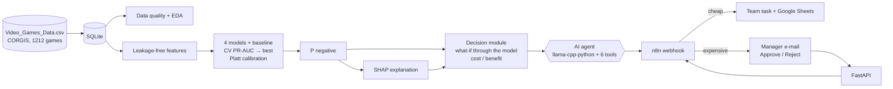

# 🎮 Negative Review Guard

**A system for predicting negative customer reviews and automatically selecting measures to prevent them**

[🇷🇺 Русский](README.md) · [🇷🇴 Română](README.ro.md) · 🇬🇧 English

[](https://github.com/Dwarfpt/Machine-Learning-Master/actions/workflows/tests.yml)      

An end-to-end ML system: **Data → ML → Prediction → Explanation (SHAP) → AI agent → Action (n8n, Human-in-the-loop)**.
Before release, a video game publisher estimates the probability that a game will get a negative critic review and sees
*why*. The agent then picks preventive measures that pay off and starts them; expensive ones wait for manager approval.


## Quick start
The whole stack (API, web app, GPU LLM, n8n, mail):
```bash
git clone https://github.com/Dwarfpt/Machine-Learning-Master.git
cd Machine-Learning-Master
cp .env.example .env
pip install huggingface_hub && hf download Qwen/Qwen2.5-3B-Instruct-GGUF qwen2.5-3b-instruct-q4_k_m.gguf --local-dir models
docker compose up -d --build
docker compose exec n8n sh /workflows/setup_n8n.sh && docker compose restart n8n
```
Then open http://localhost:8501. Details: the Run section; defence walkthrough: [docs/DEMO.md](docs/DEMO.md) (RU).

## Screenshots

| | |
|---|---|
| <br>Dashboard and data quality | <br>Model comparison and SHAP |
| <br>Prediction, SHAP factors and measures | <br>AI agent report and created actions |
| <br>Approval queue (Human-in-the-loop) | <br>Monitoring and data drift |

## Architecture



## Requirements mapping

| # | Requirement | Implementation |
|---|---|---|
| 1 | Data & database | CSV → SQLite (`nrg/db.py`); 9 data-quality checks (`nrg/quality.py`); EDA in `notebooks/01_EDA_and_modeling.ipynb` and on the dashboard |
| 2 | ≥2 ML models | Logistic Regression, Random Forest, LightGBM and XGBoost, plus a baseline; grid search, 5-fold CV, selection by PR-AUC, time-based test set (2008 releases) |
| 3 | Explainable AI | SHAP aggregated back to the original features; global importance, a beeswarm plot, and a per-prediction explanation in 3 languages |
| 4 | Web app | Streamlit: dashboard, model comparison/XAI, new-game form, prediction with SHAP, measures and the agent, approval queue, monitoring. REST API (`/docs`) |
| 5 | AI agent | A local **Qwen2.5-3B (GGUF) LLM via llama-cpp-python** (Qwen-native tool calling, `nrg/llm.py`) with **6 tools**: database (prediction, similar games, publisher history), ML model (SHAP, what-if simulation of measures) and action (`submit_action_plan` → n8n). Guardrails, plus a rule-based fallback when no LLM is available |
| 6 | Automation / RPA | `n8n/nrg_workflow.json`: webhook → Google Sheets → needs approval? → e-mail to the manager with Approve/Reject links (**Human-in-the-loop**) → API → team task |
| 7 | Bonus | MLflow, Docker Compose (api, app, llm, n8n, mailpit), data-drift monitoring (PSI), pytest |

## Data
[CORGIS Video Games](https://corgis-edu.github.io/corgis/csv/video_games/) is an open dataset of 1,212 games released 2004–2008. Target: **negative review = critic score < 60** (22.8% of games).

**Data-quality findings:**
- 6 boolean columns are **constant** (always `True`). They were dropped and rebuilt: handheld from the console, multiplatform from titles repeated across consoles, sequel from the title.
- 21.8% of publishers are missing; they become `Unknown`.
- **Leakage:** sales, used price and poll counts are only known after release, so they are excluded. A missing game length also signals an unpopular game (31% flops vs 20%), so the model trains only on the 906 games with a known length.

## Results (test = 2008 releases)

| Model | CV PR-AUC | Test PR-AUC | Test ROC-AUC |
|---|---|---|---|
| Baseline | 0.208 | 0.177 | 0.500 |
| Logistic Regression | 0.355 | 0.333 | 0.647 |
| Random Forest | 0.439 | 0.367 | 0.714 |
| LightGBM | 0.410 | 0.342 | 0.708 |
| **XGBoost** ✅ | **0.441** | **0.385** | 0.703 |

The models reach about twice the baseline PR-AUC. Top SHAP drivers: main story length, Simulation genre, sequel, publisher reputation and experience.

## Run
```bash
python -m venv .venv
```
```bash
.venv\Scripts\pip install -r requirements.txt
```
```bash
.venv\Scripts\python -m nrg.train
```
```bash
.venv\Scripts\streamlit run app/streamlit_app.py
```
```bash
.venv\Scripts\uvicorn api.main:app --port 8000
```
Local LLM: `pip install -r requirements-llm.txt --extra-index-url https://abetlen.github.io/llama-cpp-python/whl/cpu` and put `qwen2.5-3b-instruct-q4_k_m.gguf` (~2 GB) into `models/`. Docker: `docker compose up -d --build`, then `docker compose exec n8n sh /workflows/setup_n8n.sh` and `docker compose restart n8n` (Mailpit test mailbox: http://localhost:8025). The LLM makes the decision; every figure in the report comes from the tools (guardrails). The UI has an RU / RO / EN language switch.

[README.md](README.md) has the full details: the measure catalog, n8n setup, the demo script and the limitations.

## Limitations
- The dataset is small (~900 games) and only pre-release features are used, so model quality is moderate.
- The effect of process measures (QA, playtests, PR) is a configurable assumption.
- The what-if effects are correlational, not causal.
- The data covers 2004–2008.
