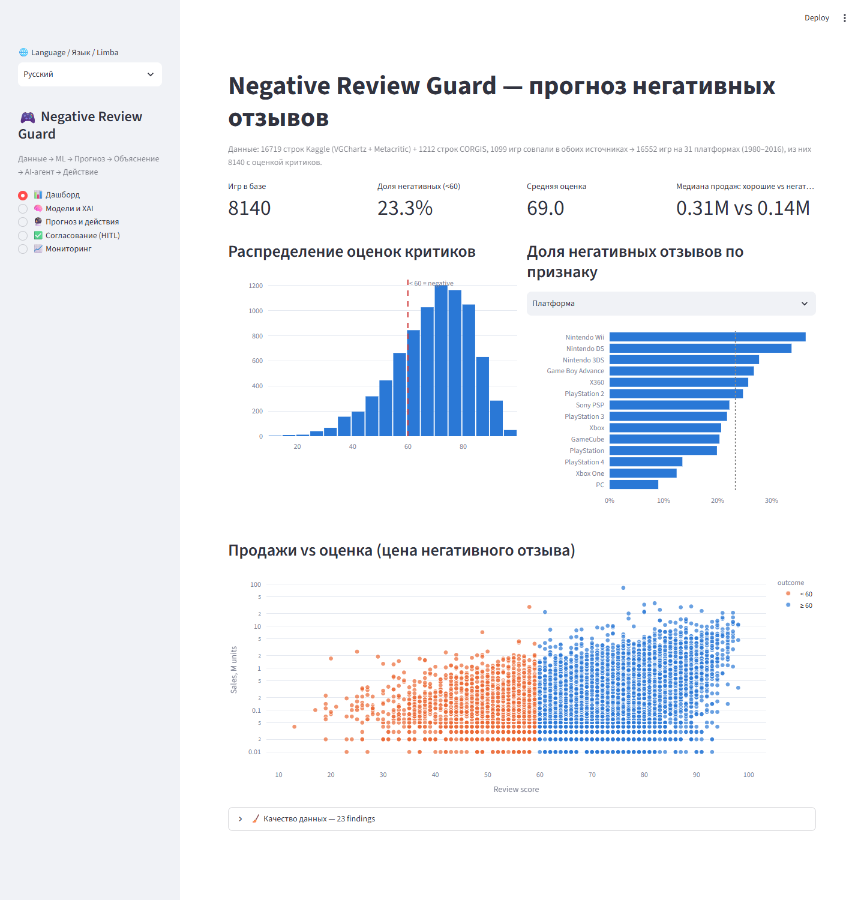
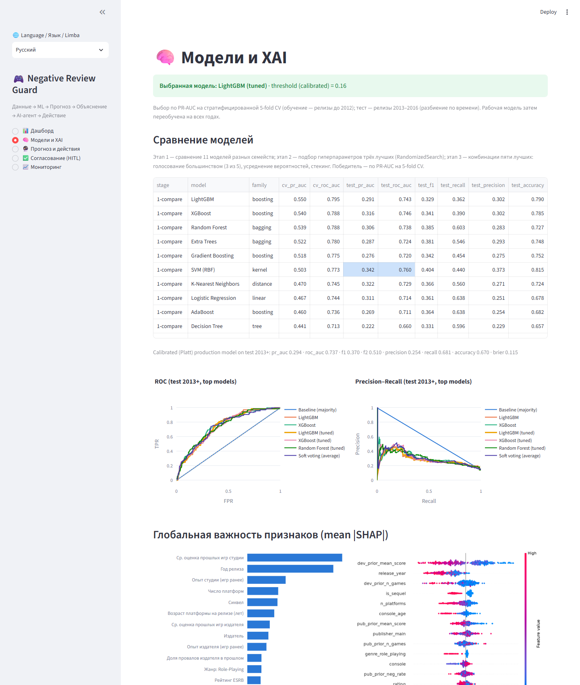
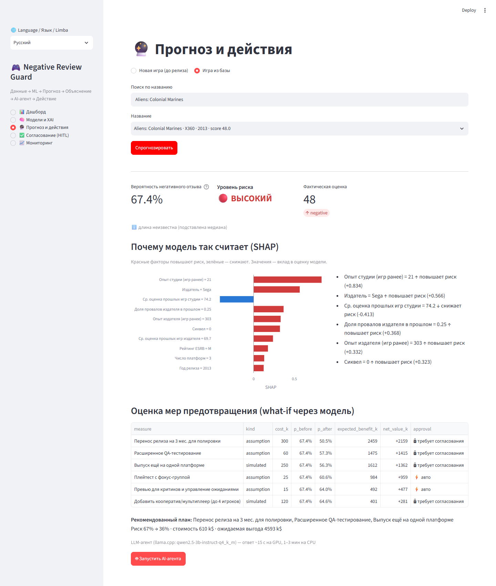
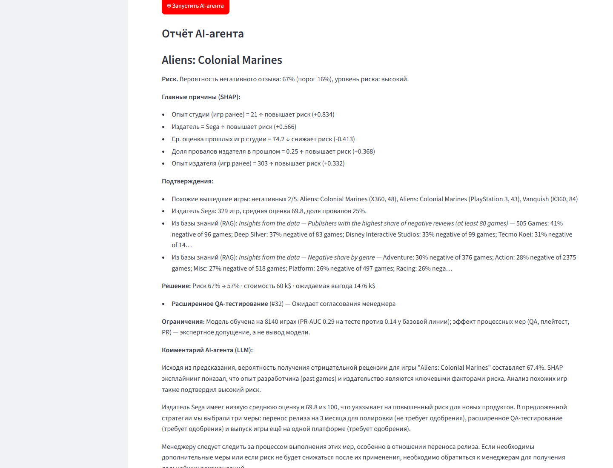
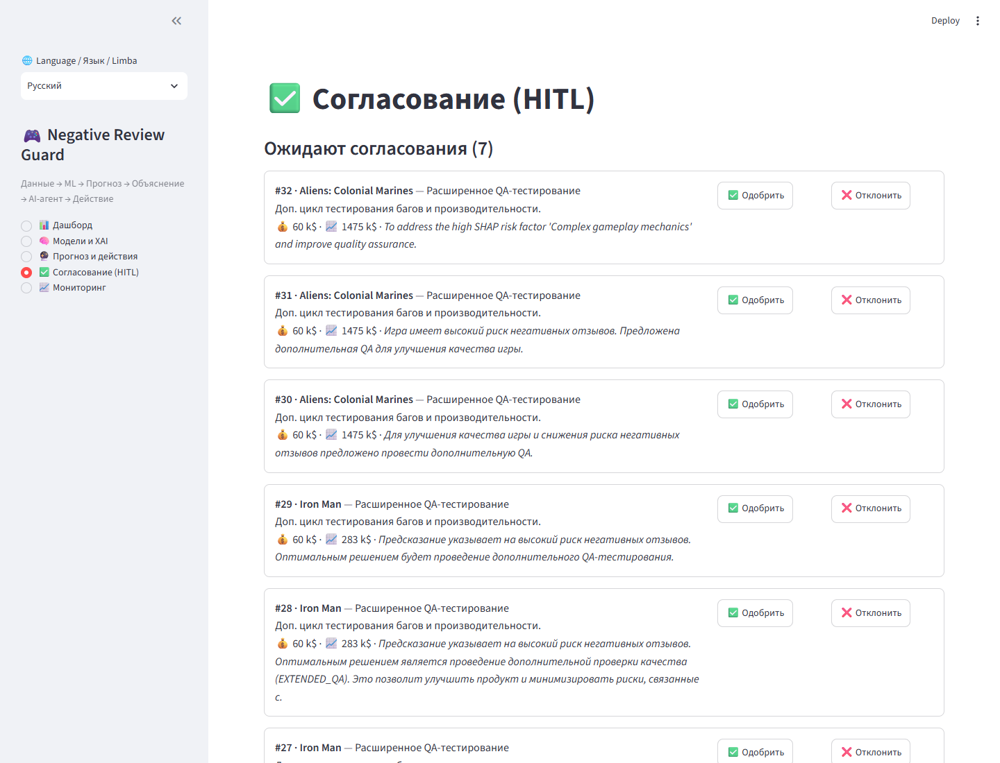
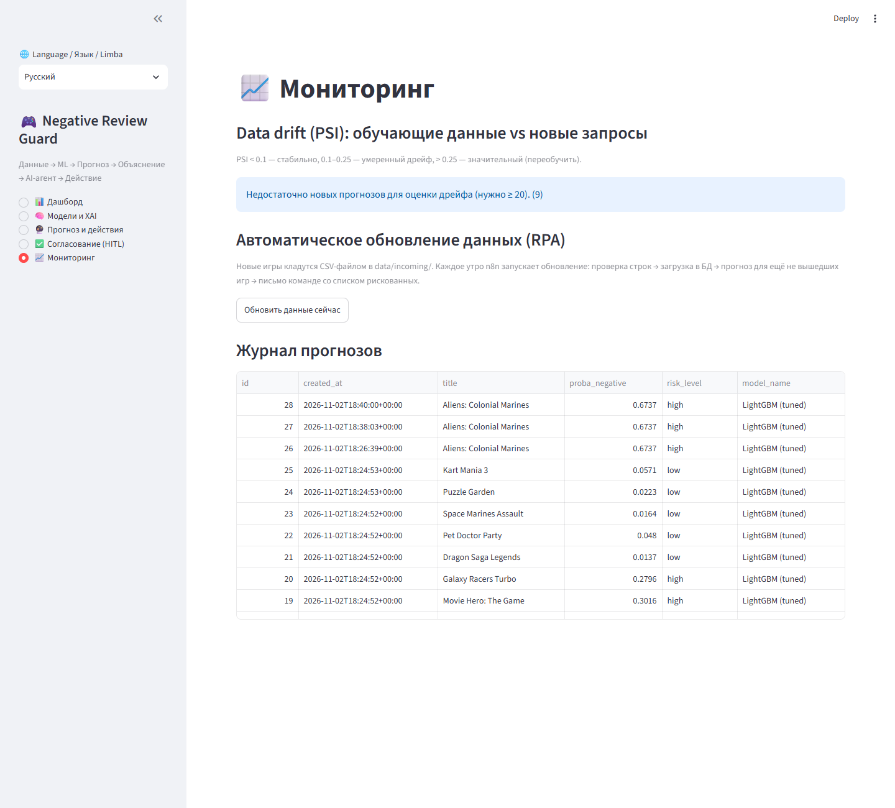
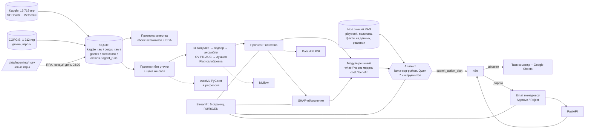

# 🎮 Negative Review Guard

**Реализация системы прогнозирования негативных отзывов покупателей и автоматизированного выбора мер по их предотвращению**

🇷🇺 Русский · [🇷🇴 Română](README.ro.md) · [🇬🇧 English](README.en.md)

[](https://github.com/Dwarfpt/Machine-Learning-Master/actions/workflows/tests.yml)      

End-to-end ML-система: **Данные → ML → Прогноз → Объяснение (SHAP) → AI-агент → Действие (n8n, Human-in-the-loop)**.
Издатель видеоигр **до релиза** оценивает вероятность того, что игра получит негативный отзыв критиков, понимает *почему*,
а агент выбирает окупающиеся меры предотвращения и запускает их (дорогие — после согласования менеджером).


## Быстрый старт
Весь стек (API, веб-приложение, LLM на GPU, n8n, почта):
```bash
git clone https://github.com/Dwarfpt/Machine-Learning-Master.git
cd Machine-Learning-Master
cp .env.example .env
pip install huggingface_hub && hf download Qwen/Qwen2.5-3B-Instruct-GGUF qwen2.5-3b-instruct-q4_k_m.gguf --local-dir models
docker compose up -d --build
docker compose exec n8n sh /workflows/setup_n8n.sh && docker compose restart n8n
```
Затем откройте http://localhost:8501. Подробности — в разделе «Запуск», сценарий защиты — [docs/DEMO.md](docs/DEMO.md).

## Как это выглядит

| | |
|---|---|
| <br>Дашборд и качество данных | <br>Сравнение моделей и SHAP |
| <br>Прогноз, SHAP-факторы и оценка мер | <br>Отчёт AI-агента и созданные действия |
| <br>Очередь согласования (Human-in-the-loop) | <br>Мониторинг и data drift |

## Архитектура



## Соответствие требованиям

| # | Требование | Реализация |
|---|---|---|
| 1 | Данные и БД | **2 источника** (Kaggle + CORGIS) → SQLite: исходные таблицы + объединённая `games` (`nrg/sources.py`, `nrg/db.py`); 23 проверки качества по обоим источникам (`nrg/quality.py`); EDA в `notebooks/01_EDA_and_modeling.ipynb` и на дашборде |
| 2 | ≥2 ML-модели | **11 моделей** 7 семейств + baseline → подбор гиперпараметров трёх лучших → ансамбли (голосование 3 из 5, усреднение, стекинг); 5-fold стратифицированная CV, выбор по PR-AUC, тест по времени 2013–2016 (`nrg/train.py`). Плюс **регрессия** оценки (`nrg/regression.py`) и **AutoML PyCaret** (`automl/`, `notebooks/02_AutoML_PyCaret.ipynb`) |
| 3 | Explainable AI | SHAP (Tree/Linear/Permutation), значения суммируются к исходным признакам; глобальная важность + beeswarm + объяснение каждого прогноза текстом на 3 языках (`nrg/explain.py`) |
| 4 | Веб-приложение | Streamlit (`app/streamlit_app.py`): дашборд, модели/XAI/регрессия/AutoML, форма новой игры, прогноз + SHAP + меры + агент, очередь согласования, мониторинг + обновление данных. REST API (`api/main.py`, Swagger на `/docs`) |
| 5 | AI-агент | `nrg/agent.py`: локальная LLM **Qwen2.5 (GGUF) через llama-cpp-python** на GPU, tool calling в формате Qwen, **7 инструментов** (БД, ML, SHAP, what-if, **RAG — база знаний**, действие). Guardrails + rule-based fallback |
| 6 | RPA / n8n | `n8n/nrg_workflow.json`: (1) действие → Google Sheets → согласование менеджером по почте (**Human-in-the-loop**) → API → таск; (2) решение менеджера; (3) **ежедневное автообновление данных**: новые игры → проверка → БД → прогноз → письмо о рискованных |
| 7 | Бонус | MLflow, Docker Compose + GPU, data drift (PSI), оценка качества агента, pytest + GitHub Actions |

Разбор замечаний преподавателя (метрики, выборка, модели, AI agent vs Agentic AI, RAG, RPA) — [docs/METHODOLOGY.md](docs/METHODOLOGY.md).

## Данные

| Источник | Строк | Что даёт |
|---|---|---|
| [Kaggle: Video Game Sales with Ratings](https://www.kaggle.com/datasets/rush4ratio/video-game-sales-with-ratings) (VGChartz + Metacritic, 2016) | 16 719 | оценка критиков, жанр, издатель, разработчик, ESRB, продажи по регионам, оценки пользователей; 31 платформа, 1980–2016 |
| [CORGIS Video Games](https://corgis-edu.github.io/corgis/csv/video_games/) | 1 212 | длина игры (HowLongToBeat), число игроков; 5 консолей, 2004–2008 |
| **Объединено** (`games`) | **16 552** | **8 140 с оценкой критиков**; 1 099 игр совпали в обоих источниках (средняя разница оценок 0.14 — тот же Metacritic) |

Целевая переменная: **негативный отзыв = оценка критиков < 60** (23.3 % игр). CSV Kaggle скачивается автоматически при
первом запуске (`nrg/sources.py`), CORGIS лежит в репозитории.

**Качество данных и утечка:** 51 % строк Kaggle без оценки (не в обучении); `user_score='tbd'`; 4 игры «из будущего»;
дубли; 6 константных колонок CORGIS (восстановлены из платформы и названия). Продажи, оценки и число отзывов
пользователей известны только после релиза → **исключены из признаков**. История издателя и студии — только по прошлым
годам. **Сезонность:** месяца в данных нет, поэтому цикл рынка моделируется возрастом платформы (`console_age`) и трендом.

## Результаты моделей

Обучение — релизы до 2012 (7 149 игр, 25 % провалов) · тест — 2013–2016 (991 игра, 14 %) · выбор по CV PR-AUC.

| Этап | Модель | CV PR-AUC | Test PR-AUC | Test ROC-AUC |
|---|---|---|---|---|
| — | Baseline | 0.246 | 0.142 | 0.500 |
| 1 | Logistic Regression | 0.467 | 0.311 | 0.714 |
| 1 | K-Nearest Neighbors | 0.470 | 0.322 | 0.729 |
| 1 | SVM (RBF) | 0.503 | 0.342 | 0.760 |
| 1 | Random Forest | 0.539 | 0.306 | 0.738 |
| 1 | XGBoost | 0.540 | 0.316 | 0.746 |
| 1 | LightGBM | 0.550 | 0.291 | 0.743 |
| 2 | **LightGBM (tuned) ✅** | **0.574** | 0.294 | 0.737 |
| 3 | Голосование большинством (3 из 5) | 0.488 | 0.259 | 0.696 |
| 3 | Усреднение вероятностей | 0.574 | 0.311 | 0.736 |
| 3 | Стекинг | 0.486 | 0.281 | 0.712 |

Полная таблица (ещё Naive Bayes, Decision Tree, Extra Trees, AdaBoost, Gradient Boosting) — на странице «Модели и XAI».
Все модели ≈ в 2 раза лучше baseline. Рабочая модель калибрована (Platt), порог по F2: на тесте находит **68 % провалов**.
**Регрессия** оценки: MAE 8.3 балла (CV), R² 0.42. **PyCaret** независимо выбрал Random Forest (CV PR-AUC 0.573).
Главные факторы (SHAP): история студии-разработчика, тренд по годам, опыт студии, число платформ, сиквел, возраст платформы.

## Модуль решений и AI-агент

Каталог мер (`nrg/actions.py`):

| Мера | Тип | Стоимость | Согласование |
|---|---|---|---|
| Расширить контент (+50% сюжета) | simulated (what-if через модель) | 180 k$ | 🔒 |
| Добавить мультиплеер (до 4) | simulated | 120 k$ | 🔒 |
| Выпуск ещё на одной платформе | simulated | 250 k$ | 🔒 |
| Перенос релиза на 3 мес. | assumption (−25% риска) | 300 k$ | 🔒 всегда |
| Расширенное QA | assumption (−15%) | 60 k$ | 🔒 (> 50 k$) |
| Плейтест с фокус-группой | assumption (−10%) | 25 k$ | ⚡ авто |
| Превью для критиков / PR | assumption (−5%) | 15 k$ | ⚡ авто |

`Ожидаемая выгода = (p_до − p_после) × выручка под риском`, где выручка под риском — разница медианных продаж хороших и
негативных игр на этой платформе × $40. План = до 3 мер с положительной чистой выгодой; при низком риске — только мониторинг.

**Инструменты агента:** `get_prediction`, `explain_prediction`, `find_similar_games`, `get_publisher_track_record`,
`evaluate_preventive_measures`, `search_knowledge_base` (RAG), `submit_action_plan`.

**RAG:** база знаний `docs/kb/` (playbook мер, политика компании, факты, посчитанные из данных) + журнал прошлых решений
менеджера; поиск TF-IDF по символьным n-граммам (RU/RO/EN), найденные фрагменты попадают в отчёт агента (`nrg/rag.py`).

**Как устроен LLM-агент (llama-cpp-python):**
- Модель по умолчанию: `Qwen2.5-3B-Instruct-Q4_K_M.gguf` (~2 ГБ) на GPU (RTX 3060, Docker); 7B включается в `.env`.
- Tool calling реализован вручную в родном формате Qwen2.5: схемы в `<tools>`, вызовы `<tool_call>{...}</tool_call>`,
  ответы `<tool_response>`. Один код работает и с моделью в процессе, и с сервером `llama_cpp.server` (Docker).
- **Разделение ролей:** LLM *принимает решение* и пишет комментарий аналитика; **все цифры в отчёте берутся из
  инструментов/БД** — модель не может их исказить.
- **Guardrails:** `enum` допустимых кодов; несуществующие коды отклоняются; план фиксируется ровно один раз (иначе —
  план модуля решений); при низком риске — только мониторинг; фильтр китайских символов (особенность Qwen).
- Без модели работает детерминированный rule-based агент с теми же инструментами.

**RPA — автообновление данных** (`nrg/refresh.py`, `POST /data/refresh`, n8n «Every day 08:00»): CSV новых игр в
`data/incoming/` → проверка строк → БД (дубли пропускаются) → прогноз для ещё не вышедших игр → пересчёт фактов RAG →
журнал + Google Sheets → письмо команде о рискованных. Пример файла — `docs/examples/incoming_example.csv`.

## Запуск

### Локально (Windows)
```bash
python -m venv .venv
```
```bash
.venv\Scripts\pip install -r requirements.txt
```
```bash
.venv\Scripts\python -m nrg.db
```
```bash
.venv\Scripts\python -m nrg.train
```
```bash
.venv\Scripts\streamlit run app/streamlit_app.py
```
```bash
.venv\Scripts\uvicorn api.main:app --port 8000
```

LLM-агент (llama-cpp-python, готовые CPU-колёса — компилятор не нужен):
```bash
.venv\Scripts\pip install -r requirements-llm.txt --extra-index-url https://abetlen.github.io/llama-cpp-python/whl/cpu
```
Скачать модель (~2 ГБ) в `models/`:
```bash
.venv\Scripts\hf download Qwen/Qwen2.5-3B-Instruct-GGUF qwen2.5-3b-instruct-q4_k_m.gguf --local-dir models
```
Агент сам загрузит модель при первом запуске. Другую GGUF-модель (например, 7B — качественнее, но медленнее) можно указать в `LLM_MODEL_PATH`.

MLflow UI:
```bash
.venv\Scripts\mlflow ui --backend-store-uri sqlite:///mlflow.db
```

Регрессия, AutoML, обновление данных, тесты:
```bash
.venv\Scripts\python -m nrg.regression
```
```bash
.venv\Scripts\python -m nrg.export_dataset
```
```bash
.venv-automl\Scripts\python automl\pycaret_automl.py
```
```bash
.venv\Scripts\python -m nrg.refresh
```
```bash
.venv\Scripts\python -m pytest -q
```
PyCaret 3.3 работает только на Python ≤ 3.11, поэтому для него отдельное окружение:
`py -3.11 -m venv .venv-automl` → `.venv-automl\Scripts\pip install pycaret==3.3.2 nbformat nbclient`.

### Docker (весь стек)
```bash
docker compose up -d --build
```
(модель должна лежать в `models/` — см. выше; контейнер `llm` поднимает `llama_cpp.server` на порту 8080)

Настроить n8n (импорт workflow + SMTP Mailpit + активация) одной командой и перезапустить:
```bash
docker compose exec n8n sh /workflows/setup_n8n.sh
```
```bash
docker compose restart n8n
```
Приложение: http://localhost:8501 · API: http://localhost:8000/docs · n8n: http://localhost:5678 · тестовая почта (Mailpit): http://localhost:8025 · MLflow: `docker compose --profile mlflow up -d` → http://localhost:5000

### Настройка n8n
1. В Docker всё делает `n8n/setup_n8n.sh`: импортирует SMTP-credential для **Mailpit** (локальный тестовый почтовый ящик) и workflow, активирует его. Вручную: n8n → *Workflows → Import from file* → `n8n/nrg_workflow.json` (пересоздать: `python n8n/build_workflow.py`).
2. Активировать workflow. В `.env` задать `N8N_WEBHOOK_URL` и `N8N_DECISION_WEBHOOK_URL` (для Docker уже заданы).
3. Без n8n события пишутся в `data/outbox.jsonl` — их видно на странице «Мониторинг».

### Настоящая почта (Gmail)
По умолчанию письма уходят в Mailpit (http://localhost:8025). Чтобы слать на реальный ящик:
1. В аккаунте Google включить **двухэтапную аутентификацию**, затем создать **пароль приложения**: https://myaccount.google.com/apppasswords (16 символов). Обычный пароль Gmail для SMTP не подойдёт.
2. В n8n (http://localhost:5678) → **Credentials** → `SMTP (Mailpit)` → изменить поля:
   *User* = ваш Gmail, *Password* = пароль приложения, *Host* = `smtp.gmail.com`, *Port* = `465`, *SSL/TLS* = вкл. → **Save**.
   (Скрипт `setup_n8n.sh` этот credential больше не перезаписывает.)
3. В `.env` указать адреса: `NRG_MAIL_FROM` = ваш Gmail (Gmail требует совпадения отправителя), `NRG_MANAGER_EMAIL`, `NRG_TEAM_EMAIL` (можно тот же ящик).
4. `docker compose up -d n8n` — n8n перечитает переменные. Для Outlook: `smtp-mail.outlook.com`, порт `587`, SSL выкл. (STARTTLS).

### Google Sheets (журнал действий и решений)
Используется **сервисный аккаунт** Google — без OAuth-окон, удобно для self-hosted n8n.
1. https://console.cloud.google.com → создать проект → *APIs & Services → Library* → включить **Google Sheets API**.
2. *IAM & Admin → Service Accounts → Create* (роль не нужна) → вкладка **Keys → Add key → JSON** → сохранить файл как `n8n/google_service_account.json` (в git не попадает).
3. Создать Google-таблицу, переименовать лист в **`Actions`**. Скопировать ID из адреса `https://docs.google.com/spreadsheets/d/<ID>/edit` в `.env`: `NRG_GSHEET_ID=<ID>`.
4. Выполнить `python n8n/setup_google.py` — он создаст credential для n8n, включит узлы логирования и напечатает **email сервисного аккаунта** и **строку заголовков** — вставить её в ячейку A1, а таблицу открыть на редактирование (Share → Editor) этому email.
5. `docker compose exec n8n sh /workflows/setup_n8n.sh`, затем `docker compose restart n8n`.
Каждое созданное действие и каждое решение менеджера появятся новой строкой (событие, мера, стоимость, статус, кто решил). Ошибка Sheets не ломает основной процесс (узел `onError: continue`).

### Удалённый доступ (WireGuard / локальная сеть)
Все сервисы слушают на всех интерфейсах компьютера, поэтому с другого устройства в той же VPN или сети они открываются
по IP компьютера: приложение `http://<IP>:8501`, API `http://<IP>:8000/docs`, n8n `:5678`, Mailpit `:8025`,
MLflow `:5000` (`docker compose --profile mlflow up -d mlflow`).
1. В `.env` указать `NRG_API_PUBLIC_URL=http://<IP>:8000`, чтобы ссылки Approve/Reject в письмах открывались
   с другого устройства, затем `docker compose up -d api app`.
2. Если порты не открываются — разрешить их в брандмауэре Windows только на интерфейсе VPN (PowerShell от администратора):
   `New-NetFirewallRule -DisplayName "NRG via VPN" -Direction Inbound -Action Allow -Protocol TCP -LocalPort 8000,8501,5678,8025,5000 -InterfaceAlias <имя адаптера>`.
3. Редактор n8n по обычному http пускает только с localhost (защищённая cookie); для входа с другого устройства нужен
   HTTPS или осознанно выставленный `N8N_SECURE_COOKIE=false`. Вебхуки и письма работают без этого.

### GPU (NVIDIA) для LLM-агента
Контейнер `llm` (Dockerfile.llm) использует CUDA и выгружает все слои модели на видеокарту (`--n_gpu_layers -1`):
нужна Docker Desktop с WSL2 и драйвер NVIDIA (проверка: `docker run --rm --gpus all nvidia/cuda:12.4.1-base-ubuntu22.04 nvidia-smi`).
Без видеокарты — в `docker-compose.yml` заменить `dockerfile: Dockerfile.llm` на `Dockerfile.llm-cpu` и убрать блок `deploy`.
Локальный запуск (без Docker для приложения) может пользоваться GPU-сервером: `LLM_BASE_URL=http://localhost:8081` в `.env`.

### Оценка агента
`python -m nrg.eval_agent --tag 3b` прогоняет агента на 30 тестовых играх 2013–2016 (по 10 низкого, среднего и
высокого риска) в песочнице — копия БД, без n8n — и сравнивает его план с планом модуля решений.
Результаты: `reports/agent_eval_3b.json` (RTX 3060, текущие данные и модель).

| Метрика | Qwen2.5-3B |
|---|---|
| Время одного запуска, среднее / p90 | 15 с / 17 с |
| Запусков, завершённых в режиме LLM (без отката на rule-based) | 30 из 30 |
| Агент обратился к базе знаний (RAG) | 30 из 30 |
| Выгода плана LLM от оптимума модуля решений (средний + высокий риск) | 40 % |
| Совпадение набора мер с модулем решений (Jaccard) | 0.53 |
| LLM предложила траты при низком риске → правило заменило на мониторинг | 10 из 10 |
| Срабатывание guardrail «план не зафиксирован» | 0 % |

Выводы: модель надёжно проходит цикл из 7 инструментов, но выбирает скромнее оптимума (почти всегда только QA) —
поэтому модуль решений остаётся эталоном, правило низкого риска нужно, а дорогие меры решает человек.
В прошлом прогоне (на старых данных) 7B выбирала лучше (58 % против 42 % у 3B), но была втрое медленнее (43 с);
включается в `.env`: `LLM_MODEL_FILE=qwen2.5-7b-instruct-q4_k_m-00001-of-00002.gguf`, `LLM_NAME=qwen2.5-7b-instruct-q4_k_m`
(файлы: `hf download Qwen/Qwen2.5-7B-Instruct-GGUF --include "qwen2.5-7b-instruct-q4_k_m*" --local-dir models`).

## Сценарий демонстрации (защита)
Подробный сценарий с играми, цифрами и репликами — [docs/DEMO.md](docs/DEMO.md).

1. **Дашборд** — два источника, доля негативных, цена провала в продажах, качество данных.
2. **Модели и XAI** — 3 этапа (11 моделей → подбор → ансамбли), регрессия, AutoML, SHAP.
3. **Хит** (Grand Theft Auto V) → только мониторинг.
4. **Провал** (Aliens: Colonial Marines, 2013) → агент с RAG → QA на согласование → письмо менеджеру.
5. **Согласование** → n8n → таск команде, Google Sheets.
6. **Новая игра + what-if**: разработчик/сиквел/издатель меняют риск на глазах.
7. **RPA**: файл новых игр 2017 года → «Обновить данные сейчас» → 7 добавлено, 2 отбраковано, письмо о рискованных.

## Структура проекта
```
negative-review-guard/
├── nrg/                    # ядро системы
│   ├── config.py           # настройки (.env)
│   ├── sources.py          # 2 источника (Kaggle + CORGIS): загрузка, сопоставление, объединение
│   ├── db.py               # SQLite: kaggle_raw, corgis_raw, games, predictions, actions, agent_runs
│   ├── quality.py          # проверки качества обоих источников
│   ├── features.py         # признаки без утечки, preprocessing pipeline
│   ├── train.py            # 11 моделей → подбор → ансамбли, выбор, калибровка, MLflow
│   ├── ensembles.py        # голосование большинством (3 из 5)
│   ├── regression.py       # регрессия: прогноз самой оценки
│   ├── export_dataset.py   # выгрузка признаков для PyCaret
│   ├── calibration.py      # Platt scaling
│   ├── explain.py          # SHAP
│   ├── predict.py          # сервис прогнозов, похожие игры, история издателя
│   ├── actions.py          # каталог мер, what-if, cost/benefit, правило согласования
│   ├── agent.py            # AI-агент: 7 инструментов, guardrails, rule-based fallback
│   ├── rag.py              # RAG: база знаний агента (docs/kb + прошлые решения)
│   ├── refresh.py          # RPA: автообновление данных из data/incoming
│   ├── eval_agent.py       # оценка агента против модуля решений
│   ├── llm.py              # llama-cpp-python: Qwen tool calling (in-process / server)
│   ├── automation.py       # n8n webhooks, токены согласования
│   ├── drift.py            # PSI data drift
│   └── i18n.py             # RU / RO / EN
├── app/streamlit_app.py    # веб-приложение
├── api/main.py             # REST API (FastAPI)
├── n8n/                    # workflow n8n, генератор, setup-скрипт, SMTP Mailpit
├── models/                 # GGUF-модель для агента (не в git)
├── automl/                 # PyCaret AutoML (Python 3.11, .venv-automl)
├── docs/                   # DEMO.md, METHODOLOGY.md, kb/ (база знаний), examples/
├── notebooks/              # 01 EDA и моделирование, 02 AutoML PyCaret (выполненные)
├── tests/                  # pytest
├── data/ artifacts/ reports/
├── Dockerfile, Dockerfile.llm, docker-compose.yml, requirements*.txt, .env.example
```

## Ограничения
- Только дорелизные признаки → качество умеренное (тест PR-AUC ≈ 0.29 при доле провалов 14 %, т.е. ≈ 2× baseline);
  модель — инструмент приоритизации, а не оракул.
- Длина игры и число игроков известны только для части игр (CORGIS); месяца релиза нет — сезонность только через цикл консоли.
- Эффект процессных мер (QA, плейтест, PR) — явные допущения, а не вывод модели; эффект *simulated*-мер — корреляционный what-if.
- Данные до 2016 г.: для реального применения нужно переобучение на актуальных данных (есть мониторинг дрейфа и RPA-загрузка).
