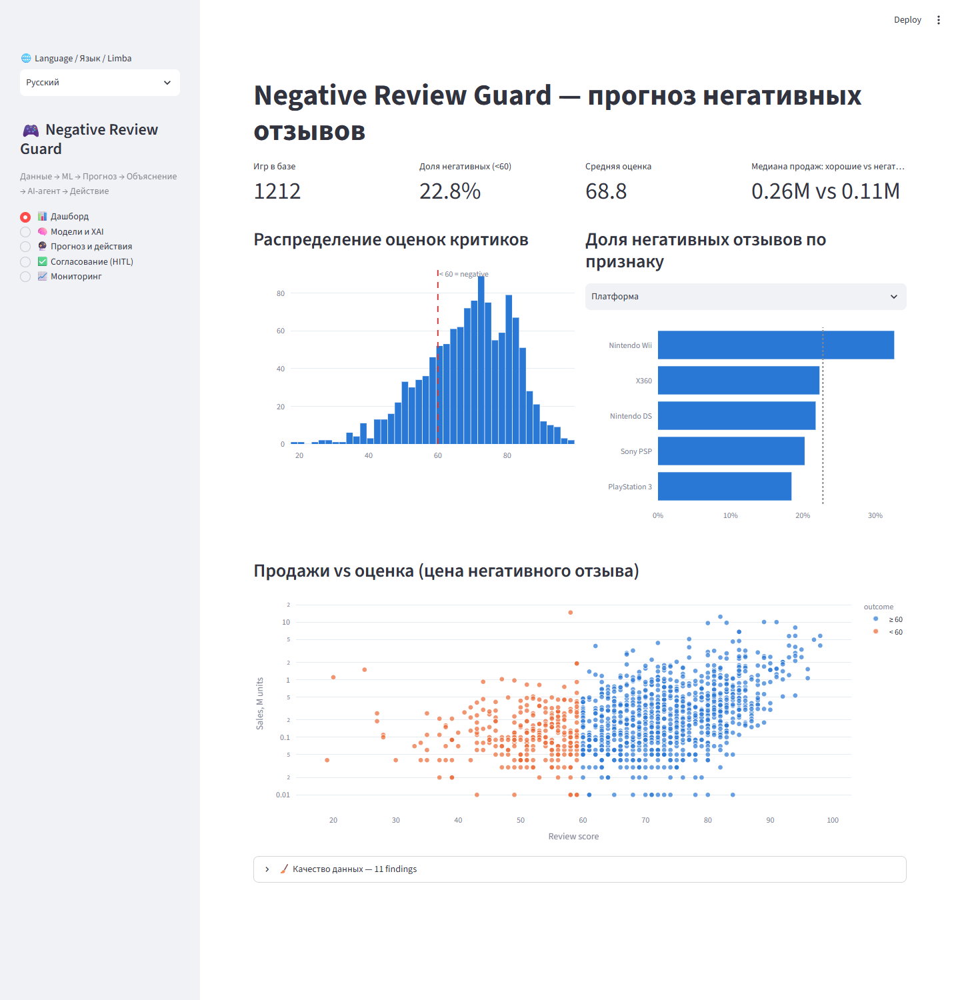
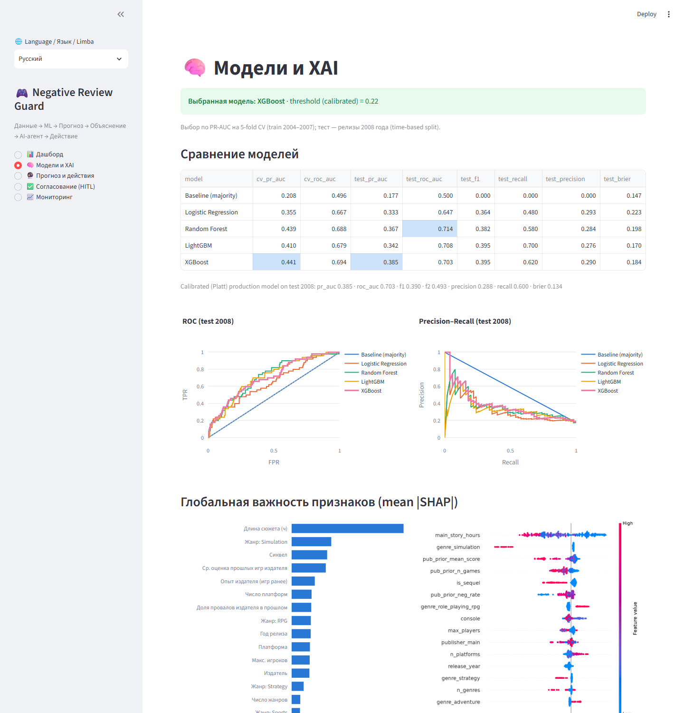
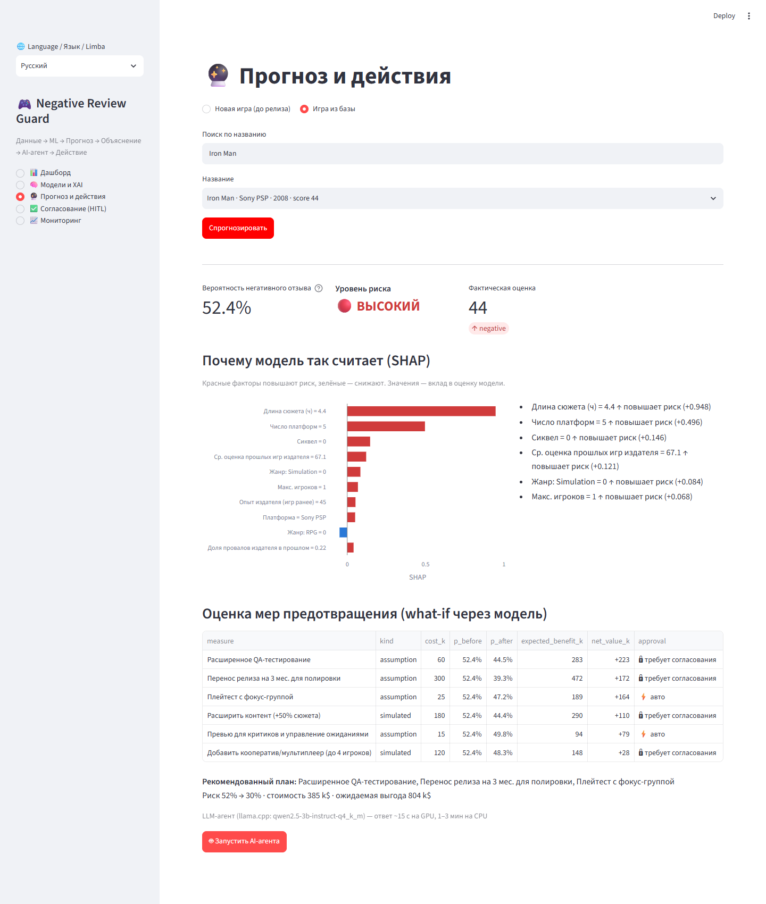
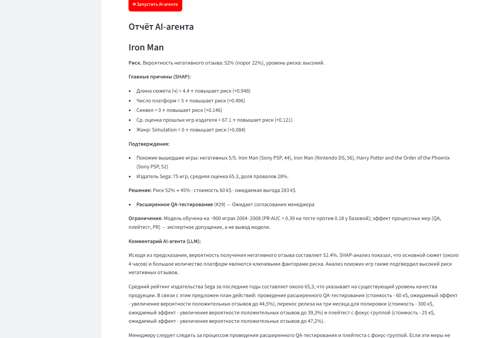
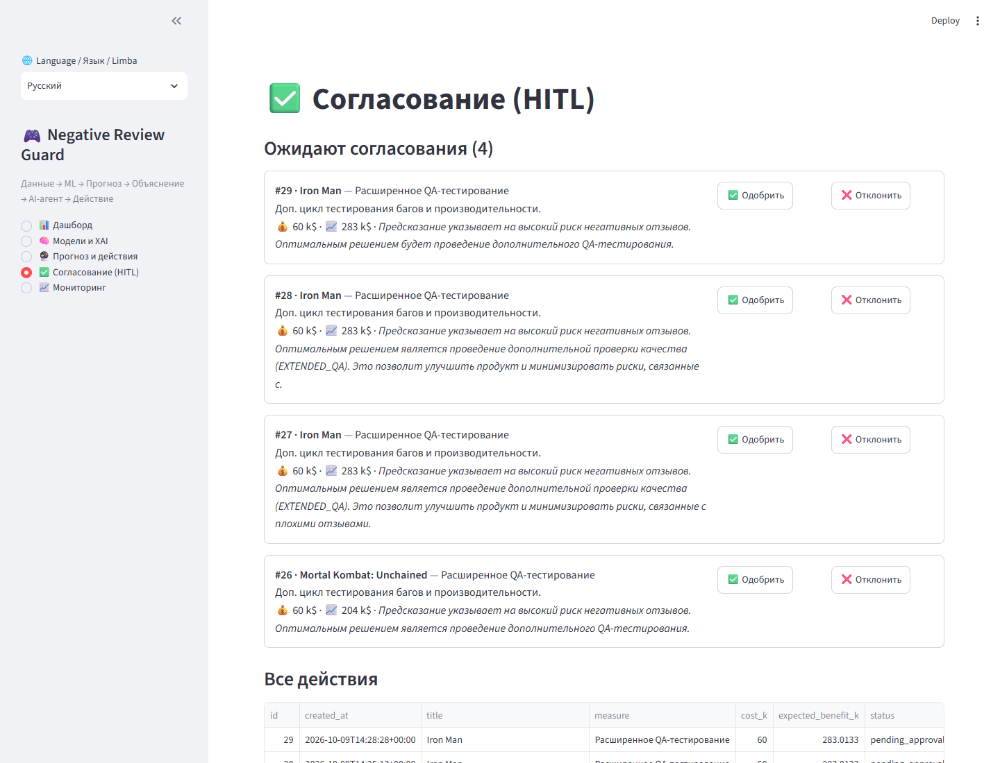
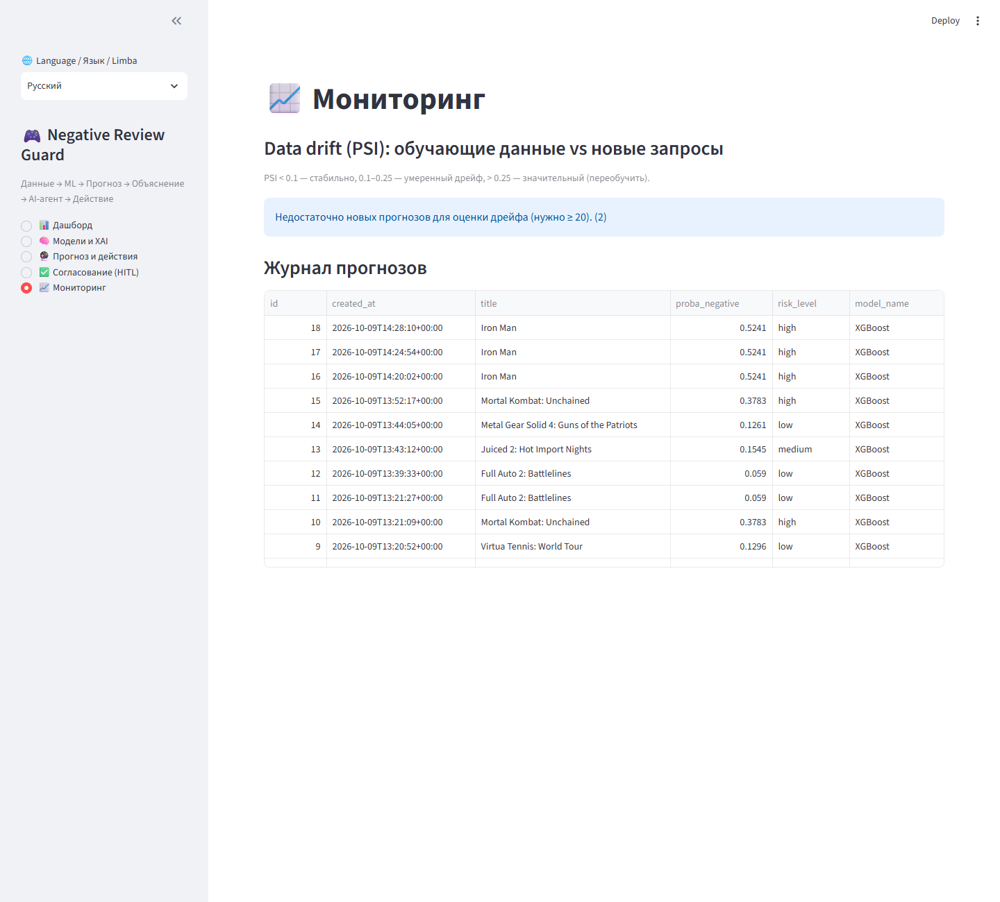
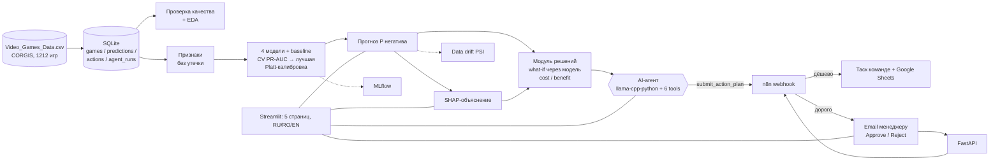

# 🎮 Negative Review Guard

**Реализация системы прогнозирования негативных отзывов покупателей и автоматизированного выбора мер по их предотвращению**

🇷🇺 Русский · [🇷🇴 Română](README.ro.md) · [🇬🇧 English](README.en.md)

[](https://github.com/Dwarfpt/Machine-Learning-Master/actions/workflows/tests.yml)      

End-to-end ML-система: **Данные → ML → Прогноз → Объяснение (SHAP) → AI-агент → Действие (n8n, Human-in-the-loop)**.
Издатель видеоигр **до релиза** оценивает вероятность того, что игра получит негативный отзыв критиков, понимает *почему*,
а агент выбирает окупающиеся меры предотвращения и запускает их (дорогие — после согласования менеджером).


## Быстрый старт
Весь стек (API, веб-приложение, LLM на GPU, n8n, почта):
```bash
git clone https://github.com/Dwarfpt/Machine-Learning-Master.git
cd Machine-Learning-Master
cp .env.example .env
pip install huggingface_hub && hf download Qwen/Qwen2.5-3B-Instruct-GGUF qwen2.5-3b-instruct-q4_k_m.gguf --local-dir models
docker compose up -d --build
docker compose exec n8n sh /workflows/setup_n8n.sh && docker compose restart n8n
```
Затем откройте http://localhost:8501. Подробности — в разделе «Запуск», сценарий защиты — [docs/DEMO.md](docs/DEMO.md).

## Как это выглядит

| | |
|---|---|
| <br>Дашборд и качество данных | <br>Сравнение моделей и SHAP |
| <br>Прогноз, SHAP-факторы и оценка мер | <br>Отчёт AI-агента и созданные действия |
| <br>Очередь согласования (Human-in-the-loop) | <br>Мониторинг и data drift |

## Архитектура



## Соответствие требованиям

| # | Требование | Реализация |
|---|---|---|
| 1 | Данные и БД | CSV → SQLite (`nrg/db.py`); 9 проверок качества (`nrg/quality.py` → `reports/data_quality.json`); EDA в `notebooks/01_EDA_and_modeling.ipynb` и на дашборде |
| 2 | ≥2 ML-модели | Logistic Regression, Random Forest, LightGBM, XGBoost + baseline; GridSearch, 5-fold CV, выбор по PR-AUC, time-based тест (релизы 2008) (`nrg/train.py`) |
| 3 | Explainable AI | SHAP (Tree/Linear Explainer), значения суммируются обратно к исходным признакам; глобальная важность + beeswarm + объяснение каждого прогноза текстом на 3 языках (`nrg/explain.py`) |
| 4 | Веб-приложение | Streamlit (`app/streamlit_app.py`): дашборд, сравнение моделей/XAI, форма новой игры, прогноз + SHAP + меры + агент, очередь согласования, мониторинг. REST API (`api/main.py`, Swagger на `/docs`) |
| 5 | AI-агент | `nrg/agent.py`: локальная LLM **Qwen2.5-3B (GGUF) через llama-cpp-python** с tool calling в родном формате Qwen (`nrg/llm.py`) и **6 инструментами**: БД (прогноз, похожие игры, история издателя), ML-модель (SHAP, what-if симуляция мер), действие (`submit_action_plan` → n8n). Guardrails: только коды из каталога, обязательная фиксация решения, rule-based fallback без LLM |
| 6 | RPA / n8n | `n8n/nrg_workflow.json`: webhook → Google Sheets → IF (нужно согласование?) → email менеджеру со ссылками Approve/Reject (**Human-in-the-loop**) → API → таск команде |
| 7 | Бонус | MLflow (все запуски, метрики, артефакты), Docker Compose (api, app, llm, n8n, mailpit, mlflow), мониторинг data drift (PSI), pytest |

## Данные

[CORGIS Video Games](https://corgis-edu.github.io/corgis/csv/video_games/) — открытый датасет: 1212 игр (2004–2008) на Nintendo DS, PSP, Wii, X360, PS3.
Целевая переменная: **негативный отзыв = `Metrics.Review Score` < 60** (22.8% игр).

**Важные находки по качеству данных:**
- 6 булевых признаков (`Handheld?`, `Multiplatform?`, `Online?`, `Licensed?`, `Sequel?`, `Re-release?`) **константны** (всегда `True`) — ошибка источника. Они удалены и восстановлены: handheld — из платформы, multiplatform — по повторам названия, sequel — регулярным выражением по названию.
- 21.8% издателей пропущено → категория `Unknown`.
- **Утечка (leakage):** `Sales`, `Used Price`, `*.Polled` известны только после релиза → исключены. Кроме того, *отсутствие* длины игры (никто не прошёл её на HowLongToBeat) — признак непопулярности: 31% провалов против 20%. Поэтому модель обучается только на 906 играх с известной длиной, а в форме плановая длина обязательна.
- Репутация издателя (`pub_prior_*`) считается **только по играм прошлых лет** (с байесовским сглаживанием).

## Результаты моделей

Train: 2004–2007 (624 игры) · Test: 2008 (282 игры) · выбор по CV PR-AUC.

| Модель | CV PR-AUC | Test PR-AUC | CV ROC-AUC | Test ROC-AUC | Test Recall | Test Precision |
|---|---|---|---|---|---|---|
| Baseline (majority) | 0.208 | 0.177 | 0.496 | 0.500 | 0.00 | 0.00 |
| Logistic Regression | 0.355 | 0.333 | 0.667 | 0.647 | 0.48 | 0.29 |
| Random Forest | 0.439 | 0.367 | 0.688 | 0.714 | 0.58 | 0.28 |
| LightGBM | 0.410 | 0.342 | 0.679 | 0.708 | 0.70 | 0.28 |
| **XGBoost** ✅ | **0.441** | **0.385** | 0.694 | 0.703 | 0.62 | 0.29 |

Модели ~в 2 раза лучше базовой линии по PR-AUC. RF и XGBoost статистически почти равны — это честный результат для
~900 игр и только *дорелизных* признаков. Вероятности откалиброваны (Platt): средняя p на тесте 0.21 при фактических 0.18.
Главные факторы (SHAP): длина сюжета, жанр Simulation, сиквел, репутация и опыт издателя, число платформ.

## Модуль решений и AI-агент

Каталог мер (`nrg/actions.py`):

| Мера | Тип | Стоимость | Согласование |
|---|---|---|---|
| Расширить контент (+50% сюжета) | simulated (what-if через модель) | 180 k$ | 🔒 |
| Добавить мультиплеер (до 4) | simulated | 120 k$ | 🔒 |
| Выпуск ещё на одной платформе | simulated | 250 k$ | 🔒 |
| Перенос релиза на 3 мес. | assumption (−25% риска) | 300 k$ | 🔒 всегда |
| Расширенное QA | assumption (−15%) | 60 k$ | ⚡ авто |
| Плейтест с фокус-группой | assumption (−10%) | 25 k$ | ⚡ авто |
| Превью для критиков / PR | assumption (−5%) | 15 k$ | ⚡ авто |

`Ожидаемая выгода = (p_до − p_после) × выручка под риском`, где выручка под риском — разница медианных продаж хороших и
негативных игр на этой платформе × $40. План = до 3 мер с положительной чистой выгодой; при низком риске — только мониторинг.

**Инструменты агента:** `get_prediction`, `explain_prediction`, `find_similar_games`, `get_publisher_track_record`,
`evaluate_preventive_measures`, `submit_action_plan`.

**Как устроен LLM-агент (llama-cpp-python):**
- Модель по умолчанию: `Qwen2.5-3B-Instruct-Q4_K_M.gguf` (~2 ГБ); на GPU (RTX 3060, Docker) один запуск агента ≈ 13 с, на CPU ≈ 45–80 с. Можно переключить на 7B — `LLM_MODEL_FILE` в `.env` (см. «Оценка агента»).
- Встроенный в llama-cpp-python обработчик `chatml-function-calling` не передаёт модели результаты инструментов, поэтому
  tool calling реализован вручную в родном формате Qwen2.5: схемы в `<tools>`, вызовы `<tool_call>{...}</tool_call>`
  (можно несколько за один ход), ответы `<tool_response>`. Один код работает и с моделью в процессе (`llama_cpp.Llama`),
  и с сервером `llama_cpp.server` (Docker).
- **Разделение ролей:** LLM *принимает решение* (какие инструменты вызвать, какие меры выбрать, обоснование) и пишет
  короткий комментарий аналитика; **все цифры в отчёте берутся из инструментов/БД** — маленькая модель не может их исказить.
- **Guardrails:** `enum` допустимых кодов в схеме; несуществующие коды отклоняются с подсказкой (агент повторяет вызов);
  `prediction_id` фиксируется системой; план отправляется ровно один раз; если LLM не зафиксировала план —
  записывается план модуля решений и в отчёте это явно отмечено; фильтр китайских иероглифов (особенность Qwen).
- Без модели работает детерминированный rule-based агент с теми же инструментами — система всегда выдаёт решение.

## Запуск

### Локально (Windows)
```bash
python -m venv .venv
```
```bash
.venv\Scripts\pip install -r requirements.txt
```
```bash
.venv\Scripts\python -m nrg.db
```
```bash
.venv\Scripts\python -m nrg.train
```
```bash
.venv\Scripts\streamlit run app/streamlit_app.py
```
```bash
.venv\Scripts\uvicorn api.main:app --port 8000
```

LLM-агент (llama-cpp-python, готовые CPU-колёса — компилятор не нужен):
```bash
.venv\Scripts\pip install -r requirements-llm.txt --extra-index-url https://abetlen.github.io/llama-cpp-python/whl/cpu
```
Скачать модель (~2 ГБ) в `models/`:
```bash
.venv\Scripts\hf download Qwen/Qwen2.5-3B-Instruct-GGUF qwen2.5-3b-instruct-q4_k_m.gguf --local-dir models
```
Агент сам загрузит модель при первом запуске. Другую GGUF-модель (например, 7B — качественнее, но медленнее) можно указать в `LLM_MODEL_PATH`.

MLflow UI:
```bash
.venv\Scripts\mlflow ui --backend-store-uri sqlite:///mlflow.db
```

Тесты:
```bash
.venv\Scripts\python -m pytest -q
```

### Docker (весь стек)
```bash
docker compose up -d --build
```
(модель должна лежать в `models/` — см. выше; контейнер `llm` поднимает `llama_cpp.server` на порту 8080)

Настроить n8n (импорт workflow + SMTP Mailpit + активация) одной командой и перезапустить:
```bash
docker compose exec n8n sh /workflows/setup_n8n.sh
```
```bash
docker compose restart n8n
```
Приложение: http://localhost:8501 · API: http://localhost:8000/docs · n8n: http://localhost:5678 · тестовая почта (Mailpit): http://localhost:8025 · MLflow: `docker compose --profile mlflow up -d` → http://localhost:5000

### Настройка n8n
1. В Docker всё делает `n8n/setup_n8n.sh`: импортирует SMTP-credential для **Mailpit** (локальный тестовый почтовый ящик) и workflow, активирует его. Вручную: n8n → *Workflows → Import from file* → `n8n/nrg_workflow.json` (пересоздать: `python n8n/build_workflow.py`).
2. Активировать workflow. В `.env` задать `N8N_WEBHOOK_URL` и `N8N_DECISION_WEBHOOK_URL` (для Docker уже заданы).
3. Без n8n события пишутся в `data/outbox.jsonl` — их видно на странице «Мониторинг».

### Настоящая почта (Gmail)
По умолчанию письма уходят в Mailpit (http://localhost:8025). Чтобы слать на реальный ящик:
1. В аккаунте Google включить **двухэтапную аутентификацию**, затем создать **пароль приложения**: https://myaccount.google.com/apppasswords (16 символов). Обычный пароль Gmail для SMTP не подойдёт.
2. В n8n (http://localhost:5678) → **Credentials** → `SMTP (Mailpit)` → изменить поля:
   *User* = ваш Gmail, *Password* = пароль приложения, *Host* = `smtp.gmail.com`, *Port* = `465`, *SSL/TLS* = вкл. → **Save**.
   (Скрипт `setup_n8n.sh` этот credential больше не перезаписывает.)
3. В `.env` указать адреса: `NRG_MAIL_FROM` = ваш Gmail (Gmail требует совпадения отправителя), `NRG_MANAGER_EMAIL`, `NRG_TEAM_EMAIL` (можно тот же ящик).
4. `docker compose up -d n8n` — n8n перечитает переменные. Для Outlook: `smtp-mail.outlook.com`, порт `587`, SSL выкл. (STARTTLS).

### Google Sheets (журнал действий и решений)
Используется **сервисный аккаунт** Google — без OAuth-окон, удобно для self-hosted n8n.
1. https://console.cloud.google.com → создать проект → *APIs & Services → Library* → включить **Google Sheets API**.
2. *IAM & Admin → Service Accounts → Create* (роль не нужна) → вкладка **Keys → Add key → JSON** → сохранить файл как `n8n/google_service_account.json` (в git не попадает).
3. Создать Google-таблицу, переименовать лист в **`Actions`**. Скопировать ID из адреса `https://docs.google.com/spreadsheets/d/<ID>/edit` в `.env`: `NRG_GSHEET_ID=<ID>`.
4. Выполнить `python n8n/setup_google.py` — он создаст credential для n8n, включит узлы логирования и напечатает **email сервисного аккаунта** и **строку заголовков** — вставить её в ячейку A1, а таблицу открыть на редактирование (Share → Editor) этому email.
5. `docker compose exec n8n sh /workflows/setup_n8n.sh`, затем `docker compose restart n8n`.
Каждое созданное действие и каждое решение менеджера появятся новой строкой (событие, мера, стоимость, статус, кто решил). Ошибка Sheets не ломает основной процесс (узел `onError: continue`).

### Удалённый доступ (WireGuard / локальная сеть)
Все сервисы слушают на всех интерфейсах компьютера, поэтому с другого устройства в той же VPN или сети они открываются
по IP компьютера: приложение `http://<IP>:8501`, API `http://<IP>:8000/docs`, n8n `:5678`, Mailpit `:8025`,
MLflow `:5000` (`docker compose --profile mlflow up -d mlflow`).
1. В `.env` указать `NRG_API_PUBLIC_URL=http://<IP>:8000`, чтобы ссылки Approve/Reject в письмах открывались
   с другого устройства, затем `docker compose up -d api app`.
2. Если порты не открываются — разрешить их в брандмауэре Windows только на интерфейсе VPN (PowerShell от администратора):
   `New-NetFirewallRule -DisplayName "NRG via VPN" -Direction Inbound -Action Allow -Protocol TCP -LocalPort 8000,8501,5678,8025,5000 -InterfaceAlias <имя адаптера>`.
3. Редактор n8n по обычному http пускает только с localhost (защищённая cookie); для входа с другого устройства нужен
   HTTPS или осознанно выставленный `N8N_SECURE_COOKIE=false`. Вебхуки и письма работают без этого.

### GPU (NVIDIA) для LLM-агента
Контейнер `llm` (Dockerfile.llm) использует CUDA и выгружает все слои модели на видеокарту (`--n_gpu_layers -1`):
нужна Docker Desktop с WSL2 и драйвер NVIDIA (проверка: `docker run --rm --gpus all nvidia/cuda:12.4.1-base-ubuntu22.04 nvidia-smi`).
Без видеокарты — в `docker-compose.yml` заменить `dockerfile: Dockerfile.llm` на `Dockerfile.llm-cpu` и убрать блок `deploy`.
Локальный запуск (без Docker для приложения) может пользоваться GPU-сервером: `LLM_BASE_URL=http://localhost:8081` в `.env`.

### Оценка агента (3B vs 7B)
`python -m nrg.eval_agent --tag 3b` прогоняет агента на 30 тестовых играх 2008 года (по 10 низкого, среднего и
высокого риска) в песочнице — копия БД, без n8n — и сравнивает его план с планом модуля решений.
Результаты: `reports/agent_eval_3b.json`, `reports/agent_eval_7b.json` (RTX 3060).

| Метрика | Qwen2.5-3B | Qwen2.5-7B |
|---|---|---|
| Время одного запуска, среднее / p90 | 13 с / 16 с | 43 с / 69 с |
| Выгода плана LLM от оптимума модуля решений (средний + высокий риск) | 42 % | 58 % |
| Совпадение набора мер с модулем решений (Jaccard) | 0.58 | 0.65 |
| LLM предложила траты при низком риске → правило заменило на мониторинг | 10 из 10 | 10 из 10 |
| Срабатывание guardrail «план не зафиксирован» | 0 % | 0 % |

Выводы: обе модели надёжно проходят цикл инструментов, но выбирают скромнее оптимума и никогда не берут продуктовые
меры (контент, мультиплеер) — поэтому модуль решений остаётся эталоном, правило низкого риска нужно, а дорогие меры
решает человек. 7B выбирает лучше, но втрое медленнее; для демонстрации по умолчанию стоит 3B, 7B включается в `.env`:
`LLM_MODEL_FILE=qwen2.5-7b-instruct-q4_k_m-00001-of-00002.gguf`, `LLM_NAME=qwen2.5-7b-instruct-q4_k_m`
(файлы: `hf download Qwen/Qwen2.5-7B-Instruct-GGUF --include "qwen2.5-7b-instruct-q4_k_m*" --local-dir models`).

## Сценарий демонстрации (защита)
Подробный сценарий с выбранными играми, репликами и ответами на вопросы — [docs/DEMO.md](docs/DEMO.md).

1. **Дашборд** — данные, доля негативных, «цена» негативного отзыва в продажах, отчёт о качестве данных.
2. **Модели и XAI** — таблица сравнения, ROC/PR-кривые, глобальная важность SHAP.
3. **Прогноз** → «Новая игра»: Wii, Racing, сиквел, 4 часа сюжета, 1 игрок → вероятность, риск, SHAP-факторы, таблица мер.
4. **Запустить AI-агента** → отчёт + трассировка вызовов инструментов + созданные действия.
5. **Согласование (HITL)** — одобрить перенос релиза → событие уходит в n8n → таск команде.
6. **Мониторинг** — журнал прогнозов, data drift (PSI), outbox.

## Структура проекта
```
negative-review-guard/
├── nrg/                    # ядро системы
│   ├── config.py           # настройки (.env)
│   ├── db.py               # SQLite: games, predictions, actions, agent_runs
│   ├── quality.py          # проверки качества данных
│   ├── features.py         # признаки без утечки, preprocessing pipeline
│   ├── train.py            # сравнение моделей, выбор, калибровка, MLflow
│   ├── calibration.py      # Platt scaling
│   ├── explain.py          # SHAP
│   ├── predict.py          # сервис прогнозов, похожие игры, история издателя
│   ├── actions.py          # каталог мер, what-if, cost/benefit, правило согласования
│   ├── agent.py            # AI-агент: 6 инструментов, guardrails, rule-based fallback
│   ├── llm.py              # llama-cpp-python: Qwen tool calling (in-process / server)
│   ├── automation.py       # n8n webhooks, токены согласования
│   ├── drift.py            # PSI data drift
│   └── i18n.py             # RU / RO / EN
├── app/streamlit_app.py    # веб-приложение
├── api/main.py             # REST API (FastAPI)
├── n8n/                    # workflow n8n, генератор, setup-скрипт, SMTP Mailpit
├── models/                 # GGUF-модель для агента (не в git)
├── notebooks/              # EDA и моделирование (выполненный notebook)
├── tests/                  # pytest
├── data/ artifacts/ reports/
├── Dockerfile, Dockerfile.llm, docker-compose.yml, requirements*.txt, .env.example
```

## Ограничения
- Маленький датасет (~900 размеченных игр) и только дорелизные признаки → качество умеренное (PR-AUC ≈ 0.39); модель — инструмент приоритизации, а не оракул.
- Эффект процессных мер (QA, плейтест, PR) — явные настраиваемые допущения, а не вывод модели; эффект *simulated*-мер — корреляционный what-if, не причинный.
- Данные 2004–2008 гг.: для реального применения нужно переобучение на актуальных данных (для этого есть мониторинг дрейфа).
