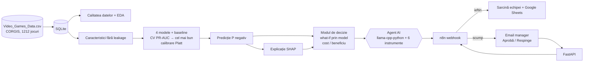

# 🎮 Negative Review Guard

**Implementarea unui sistem de prognozare a recenziilor negative ale clienților și de selecție automată a măsurilor de prevenire**

[🇷🇺 Русский](README.md) · 🇷🇴 Română · [🇬🇧 English](README.en.md)

[](https://github.com/Dwarfpt/Machine-Learning-Master/actions/workflows/tests.yml)      

Sistem ML end-to-end: **Date → ML → Predicție → Explicație (SHAP) → Agent AI → Acțiune (n8n, Human-in-the-loop)**.
Un editor de jocuri video estimează **înainte de lansare** probabilitatea ca jocul să primească o recenzie negativă de la critici,
înțelege *de ce*, iar agentul alege măsurile de prevenire rentabile și le lansează (cele costisitoare — după aprobarea managerului).


## Pornire rapidă
Întregul sistem (API, aplicație web, LLM pe GPU, n8n, e-mail):
```bash
git clone https://github.com/Dwarfpt/Machine-Learning-Master.git
cd Machine-Learning-Master
cp .env.example .env
pip install huggingface_hub && hf download Qwen/Qwen2.5-3B-Instruct-GGUF qwen2.5-3b-instruct-q4_k_m.gguf --local-dir models
docker compose up -d --build
docker compose exec n8n sh /workflows/setup_n8n.sh && docker compose restart n8n
```
Apoi deschideți http://localhost:8501. Detalii — secțiunea Pornire; scenariul demonstrației — [docs/DEMO.md](docs/DEMO.md) (RU).

## Capturi de ecran

| | |
|---|---|
| <br>Dashboard și calitatea datelor | <br>Compararea modelelor și SHAP |
| <br>Prognoză, factori SHAP și măsuri | <br>Raportul agentului AI și acțiunile create |
| <br>Coada de aprobare (Human-in-the-loop) | <br>Monitorizare și data drift |

## Arhitectura



## Conformitatea cu cerințele

| # | Cerință | Implementare |
|---|---|---|
| 1 | Date și bază de date | CSV → SQLite (`nrg/db.py`); 9 verificări de calitate (`nrg/quality.py`); EDA în `notebooks/01_EDA_and_modeling.ipynb` și în dashboard |
| 2 | Model Machine Learning (≥2) | Logistic Regression, Random Forest, LightGBM, XGBoost + baseline; GridSearch, 5-fold CV, selecție după PR-AUC, test temporal (lansările din 2008) |
| 3 | Explainable AI | SHAP agregat pe caracteristicile originale; importanță globală + beeswarm + explicația fiecărei predicții în 3 limbi |
| 4 | Aplicație web | Streamlit: dashboard, comparația modelelor/XAI, formular joc nou, predicție + SHAP + măsuri + agent, coadă de aprobare, monitorizare. REST API (`/docs`) |
| 5 | Agent AI | LLM local **Qwen2.5-3B (GGUF) prin llama-cpp-python** (tool calling în formatul nativ Qwen, `nrg/llm.py`) cu **6 instrumente**: BD (predicție, jocuri similare, istoricul editorului), model ML (SHAP, simulare what-if), acțiune (`submit_action_plan` → n8n). Guardrails + fallback rule-based |
| 6 | Automatizare / RPA | `n8n/nrg_workflow.json`: webhook → Google Sheets → IF aprobare? → email managerului cu linkuri Aprobă/Respinge (**Human-in-the-loop**) → API → sarcină echipei |
| 7 | Bonus | MLflow, Docker Compose (api, app, llm, n8n, mailpit), monitorizare data drift (PSI), pytest |

## Date
[CORGIS Video Games](https://corgis-edu.github.io/corgis/csv/video_games/) — set de date deschis: 1212 jocuri (2004–2008). Țintă: **recenzie negativă = scor < 60** (22,8%).

**Constatări privind calitatea datelor:** 6 coloane booleene sunt **constante** (mereu `True`) → eliminate și reconstruite (handheld din consolă, multiplatform din titluri repetate, sequel din titlu); 21,8% editori lipsă → `Unknown`; **leakage**: vânzările, prețul la mâna a doua și numărul de sondaje sunt cunoscute doar după lansare → excluse; lipsa duratei jocului indică impopularitate (31% eșecuri vs 20%) → antrenare doar pe 906 jocuri cu durată cunoscută.

## Rezultate (test = lansările din 2008)

| Model | CV PR-AUC | Test PR-AUC | Test ROC-AUC |
|---|---|---|---|
| Baseline | 0.208 | 0.177 | 0.500 |
| Logistic Regression | 0.355 | 0.333 | 0.647 |
| Random Forest | 0.439 | 0.367 | 0.714 |
| LightGBM | 0.410 | 0.342 | 0.708 |
| **XGBoost** ✅ | **0.441** | **0.385** | 0.703 |

Modelele sunt de ~2 ori mai bune decât baseline-ul. Factori principali (SHAP): durata poveștii, genul Simulation, continuare, reputația și experiența editorului.

## Pornire
```bash
python -m venv .venv
```
```bash
.venv\Scripts\pip install -r requirements.txt
```
```bash
.venv\Scripts\python -m nrg.train
```
```bash
.venv\Scripts\streamlit run app/streamlit_app.py
```
```bash
.venv\Scripts\uvicorn api.main:app --port 8000
```
LLM local: `pip install -r requirements-llm.txt --extra-index-url https://abetlen.github.io/llama-cpp-python/whl/cpu` și modelul `qwen2.5-3b-instruct-q4_k_m.gguf` (~2 GB) în `models/`. Docker: `docker compose up -d --build`, apoi `docker compose exec n8n sh /workflows/setup_n8n.sh` și `docker compose restart n8n` (Mailpit: http://localhost:8025). Agentul LLM ia decizia, iar toate cifrele din raport provin din instrumente (guardrails). Interfața are comutator de limbă RU / RO / EN.

Detalii complete (catalogul măsurilor, configurarea n8n, scenariul demonstrației, limitări) — în [README.md](README.md).

## Limitări
Set de date mic (~900 jocuri), doar caracteristici disponibile înainte de lansare → calitate moderată; efectul măsurilor de proces este o ipoteză configurabilă; efectul what-if este corelațional, nu cauzal; datele sunt din 2004–2008.
